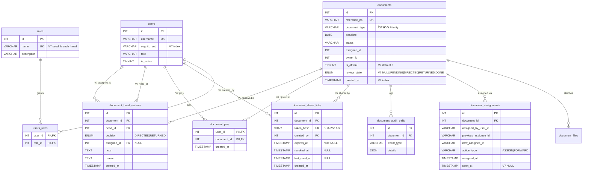

# ERD V7 — Schema ของรอบ V7

Migration: [`backend/database/migrations/v7.js`](../backend/database/migrations/v7.js) (เรียกจาก `npm run migrate` → [`backend/migrate.js`](../backend/migrate.js))
สูตร Priority ของ Inbox: [`backend/inboxPriority.js`](../backend/inboxPriority.js)
ทุก Issue Backend ของ V7 (#75, #77, #78, #79, #82, #90) ใช้ schema จากไฟล์นี้ชุดเดียว ห้ามเพิ่มตาราง/คอลัมน์ซ้ำใน Issue ตัวเอง

**หลักการ**
- ใช้ Schema เดิม: MySQL, `INT` id, `users` / `users_roles` / `document_assignments` / `document_audit_trails`. ไม่สร้างตาราง users/history ใหม่ และไม่ใช้ UUID
- เพิ่มอย่างเดียว ไม่มี DROP / RENAME / MODIFY column เดิม
- รันซ้ำได้: `CREATE TABLE IF NOT EXISTS`, เช็ก `INFORMATION_SCHEMA` ก่อน `ADD COLUMN` / `ADD INDEX`, seed แบบไม่ซ้ำ
- คอลัมน์ที่อ้างถึงผู้ใช้ใช้ชนิดเดียวกับ `users.id` ของ DB จริง (migration อ่านชนิดจาก DB ก่อน) เพื่อให้สร้าง FK ได้

## ER Diagram

ตารางและคอลัมน์ใหม่ของ V7 มี `V7` กำกับ ตารางเดิมแสดงเฉพาะคอลัมน์ที่เกี่ยวข้อง



## รายการเปลี่ยนแปลงและเหตุผล

| ตาราง / field | Issue | เหตุผลสั้น ๆ |
|---|---|---|
| `roles` + แถว `branch_head` (หัวหน้าสาขา) | #78 | ใช้ `roles` / `users_roles` เดิม (many-to-many) และ map กับ Cognito Group ได้เหมือน role อื่น ไม่ต้องมีคอลัมน์ใหม่ |
| `documents.is_official` `TINYINT(1) NOT NULL DEFAULT 0` | #79, ADR #71 | แยกหนังสือราชการที่ต้องผ่านหัวหน้าสาขา เอกสารเดิมทั้งหมดเป็น 0 จึงทำงานแบบเดิม |
| `documents.review_state` `ENUM(...) NULL` | #79, ADR #71 | `NULL` = ไม่เข้าขั้นหัวหน้าสาขา (เอกสารเดิมทุกฉบับ) ใช้ ENUM ให้ DB ปฏิเสธค่าที่สะกดผิด แยกจาก `status` เดิมเพื่อไม่กระทบ workflow V3 |
| `document_head_reviews` (append-only) | #79, ADR #71 | เก็บทุกครั้งที่สั่งการ/ส่งกลับ เป็นประวัติที่แก้ไม่ได้ (trigger ห้าม UPDATE/DELETE แบบเดียวกับ `document_audit_trails`) ส่วน `documents.review_state` คือสถานะล่าสุดสำหรับ query เร็ว |
| `document_share_links` | #75, ADR #72 | แทน Guest: เก็บแค่ `token_hash` (SHA-256) ไม่เก็บ token ดิบ ถ้า DB รั่วก็ใช้ลิงก์ไม่ได้ `expires_at` บังคับ (ไม่มีลิงก์ถาวร) `revoked_at` ใช้ยกเลิก `last_used_at` ใช้ตรวจสอบย้อนหลัง |
| `document_assignments.seen_at` `TIMESTAMP NULL` | #77 | "เปิดแล้ว/ยังไม่เปิด" ผูกกับแถวมอบหมายของผู้รับ ใช้ตารางเดิม ไม่สร้างตาราง history ใหม่ (ส่งต่อใหม่ = แถวใหม่ = ยังไม่เปิดอีกครั้ง) |
| `document_pins (user_id, document_id)` | #77, #82 | ปักดาวเป็นของแต่ละคน PK คู่กันกันปักซ้ำ ใช้ PK ตัวแรก `user_id` เป็น index ของ Inbox ได้เลย |
| Index ของ Inbox | #90 | ดูหัวข้อถัดไป |
| แก้ seed `document_types` | (repeatability) | `name` ไม่มี UNIQUE จึง `INSERT IGNORE` เดิมได้แถวซ้ำทุกครั้งที่รัน (ทดสอบแล้ว: รัน 2 ครั้งได้ 14 แถว) เปลี่ยนเป็น insert เฉพาะชื่อที่ยังไม่มี ไม่เพิ่ม UNIQUE เพราะ DB เดิมอาจมีแถวซ้ำอยู่แล้ว |
| Baseline `users`, `users_roles`, role ทั้ง 5 | (DB ว่าง) | `migrate.js` เดิมไม่สร้าง `users` ทำให้ DB ว่าง migrate ไม่ได้ ใช้ `IF NOT EXISTS` / `INSERT IGNORE` จึงไม่แตะ RDS ที่มีอยู่ |

### CHECK constraint (สำคัญกับ RDS)

RDS (MySQL 8.4.11) ใช้ `sql_mode = IGNORE_SPACE,NO_ENGINE_SUBSTITUTION` ซึ่งไม่ใช่ strict ถ้าใส่ค่านอก ENUM หรือไม่ใส่คอลัมน์ NOT NULL จะได้แค่ warning แล้วเก็บ `''` / `0000-00-00` แทนที่จะ error จึงเพิ่ม CHECK ซึ่ง MySQL บังคับไม่ว่า sql_mode เป็นอะไร (ทดสอบแล้วบน RDS: ได้ `ER_CHECK_CONSTRAINT_VIOLATED`)

| Constraint | เงื่อนไข |
|---|---|
| `chk_doc_is_official` | `is_official IN (0, 1)` |
| `chk_doc_review_state` | `review_state IS NULL OR review_state IN ('PENDING','DIRECTED','RETURNED','DONE')` |
| `chk_head_review_decision` | `decision IN ('DIRECTED','RETURNED')` |
| `chk_share_expiry` | `expires_at > created_at` (กันลิงก์ที่ไม่ใส่วันหมดอายุ) |

### FK และการลบ

- `document_id` ทุกตารางใหม่ใช้ `ON DELETE CASCADE` เหมือนตารางลูกเดิม ลบเอกสารแล้ว share link / pin / head review หายตาม (MySQL ไม่เรียก trigger กับแถวที่ลบผ่าน CASCADE จึงลบเอกสารได้แม้ `document_head_reviews` เป็น append-only พฤติกรรมเดียวกับ `document_audit_trails`)
- `document_pins.user_id` ใช้ `CASCADE` ส่วน `created_by`, `head_id`, `assignee_id` ใช้ `RESTRICT` เพราะเป็นหลักฐาน ระบบใช้ `users.is_active` ปิดผู้ใช้แทนการลบอยู่แล้ว

### Index (#90)

| Index | Query ที่ใช้ |
|---|---|
| `document_assignments (previous_assignee_id, document_id)` | `PREVIOUS_ASSIGNEE_SQL` ใน Inbox / search |
| `document_assignments (document_id, new_assignee_id)` | หาแถวมอบหมายล่าสุดของผู้ดู (`seen_at`) |
| `document_assignments (document_id, assigned_by_user_id, action_type)` | `didOfficerForward` |
| `documents (created_at)` | `ORDER BY d.created_at DESC` |
| `documents (is_official, review_state)` | คิวหัวหน้าสาขา |
| `users (cognito_sub)` | lookup ผู้ใช้ทุก request ที่ login |

`addIndexIfMissing` จะข้าม ถ้ามี index ชื่อเดียวกันหรือ index อื่นที่ขึ้นต้นด้วยคอลัมน์ชุดเดียวกันอยู่แล้ว ถ้า #90 จะเพิ่ม index ให้เพิ่มในไฟล์ v7.js นี้ ไม่ต้องสร้าง migration แยก

แถวซ้ำใน Inbox แก้ด้วย index ไม่ได้ ต้องแก้ที่ query: `LEFT JOIN document_files` ทำให้ 1 เอกสารได้หลายแถวเมื่อมีหลายไฟล์ และการ JOIN `document_assignments` ตรง ๆ ก็ซ้ำได้เช่นกัน แนวที่ทดสอบแล้วใน `test/migrationV7.test.js` คือ JOIN เฉพาะแถวล่าสุด `a.id = (SELECT MAX(a2.id) ... WHERE a2.document_id = d.id AND a2.new_assignee_id = ?)`

## สูตร Priority ของ Inbox อาจารย์

ใช้ `compareInboxPriority` (JS) หรือ `buildInboxOrderBy` (SQL) จาก `backend/inboxPriority.js` ทั้งสองแบบให้ลำดับเดียวกัน (มี test ยืนยัน)

1. ปักดาว (`document_pins`)
2. ต้องดำเนินการ: ขออนุมัติ / มอบหมายงาน / รอการตอบกลับ
3. เพื่อทราบ: ประชาสัมพันธ์ / แจ้งเพื่อทราบ / แจ้งกำหนดการ-การนัดหมาย / รายงานผล
4. เสมอกัน → `deadline` ใกล้ก่อน (ไม่มีกำหนดส่งอยู่ท้าย) → ยังไม่เปิด (`seen_at IS NULL`) ก่อน → ใหม่ก่อน
5. เกินกำหนด (`isOverdue`) เป็นป้ายเท่านั้น ไม่เลื่อนลำดับ

`documents.document_type` เก็บชื่อสั้นตาม `value` ของฟอร์ม (`ขออนุมัติ`, `กำหนดการ/การนัดหมาย`, ...) ไม่ใช่ชื่อเต็มใน `document_types` (`เอกสารขออนุมัติ`, ...) สูตรจึงรับทั้งสองแบบ

ประเภทเอกสารที่ไม่อยู่ในรายการ "เพื่อทราบ" นับเป็น "ต้องดำเนินการ" เพื่อไม่ให้งานตกหล่น หมวดอยู่ในโค้ด ไม่ได้อยู่ในตาราง `document_types` เพราะ `documents.document_type` เก็บเป็นชื่อ (ไม่มี FK) และ `document_types.name` ไม่ unique ถ้า JOIN จะได้แถวซ้ำ

## วิธีรันและทดสอบ

```bash
cd backend
npm run migrate                      # รันซ้ำได้
# integration test บน MySQL ทดสอบ (ห้ามชี้ไป RDS จริง) — สร้าง/ลบ DB v7test_* ของตัวเอง
MIGRATION_TEST_DB_URL=mysql://root@127.0.0.1:3399 node --test test/migrationV7.test.js
# ค่าเริ่มต้นใช้ sql_mode เดียวกับ RDS; ทดสอบแบบ strict เพิ่มด้วย MIGRATION_TEST_SQL_MODE=STRICT_TRANS_TABLES,NO_ENGINE_SUBSTITUTION
npm test                             # unit test (integration ด้านบนจะ skip ถ้าไม่ตั้งตัวแปร)
```

`test/migrationV7.test.js` ครอบคลุม: DB ว่าง (migrate 3 ครั้งแล้ว schema และ seed เหมือนเดิม), DB ที่มีข้อมูลเดิม (คอลัมน์/index เดิมไม่หายและไม่เปลี่ยน, จำนวนแถวเดิมครบ, query Inbox เดิมให้ผลเหมือนเดิม) และกรณีที่ต้องถูกปฏิเสธ (token_hash ซ้ำ, ไม่มี expires_at, FK ไม่มีจริง, ปักดาวซ้ำ, review_state/decision นอก ENUM, UPDATE/DELETE head review)

## ให้จูนตรวจเทียบ ADR #71 / #72

- [ ] `decision` มีแค่ `DIRECTED` / `RETURNED` ส่วน "แจกจ่าย" (#79) แสดงด้วย `review_state = DONE` + แถวใน `document_assignments` ไม่มีแถว head review แยก ตรงกับ ADR #71 หรือไม่
- [ ] กติกา "DIRECTED ต้องมี `assignee_id`" และ "RETURNED ต้องมี `reason`" ให้ API (#79) ตรวจ ไม่ใส่เป็น CHECK ใน DB เพราะยังไม่แน่ใจว่า ADR อนุญาตให้สั่งการโดยไม่ระบุผู้รับหรือไม่
- [ ] `expires_at` ของ share link เป็น NOT NULL (ไม่มีลิงก์ถาวร) ตรงกับ ADR #72 หรือไม่ และ 1 เอกสารมีหลายลิงก์พร้อมกันได้
- [ ] Share link อ่านอย่างเดียว ไม่มีคอลัมน์สิทธิ์ (permission) ถ้า ADR #72 ต้องการระดับสิทธิ์ต้องเพิ่มคอลัมน์
